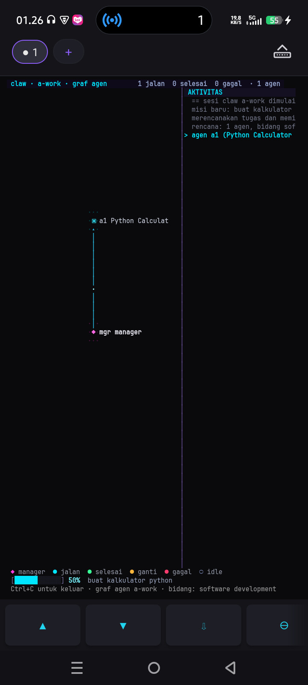
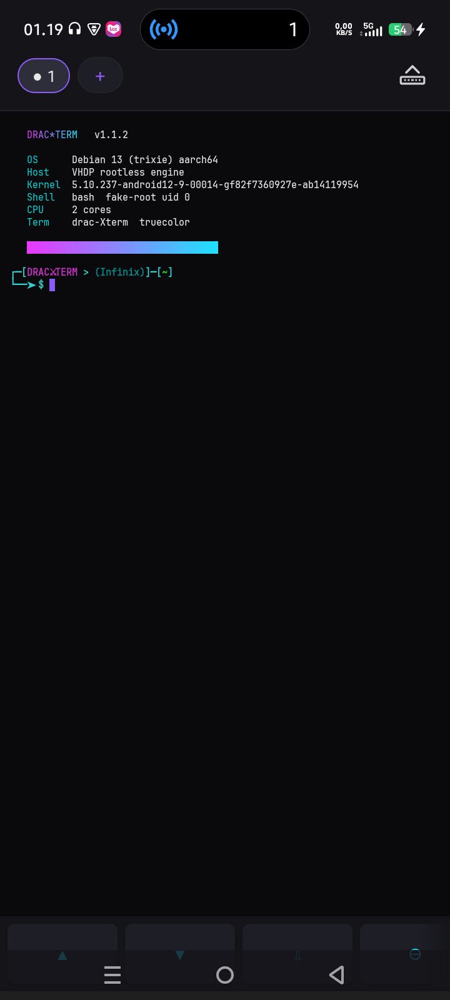
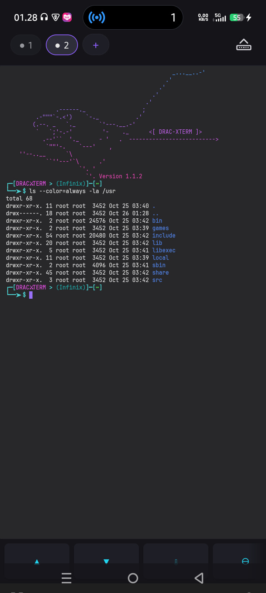

# dracxterm (dxterm)

**An open-source Android terminal that can run Debian or Kali Linux without root.**

[Bahasa Indonesia](README.md) · [Website](https://exsokamabay.github.io/dxterm/) · [Download the latest APK](https://github.com/ExsoKamabay/dxterm/releases/latest) · [Changelog](CHANGELOG.md)

[](https://github.com/ExsoKamabay/dxterm/releases/latest)
[](LICENSE)
[](#requirements)
[](#requirements)

Open dracxterm and a shell is ready. If you need a complete Linux userspace, the app can install Debian 13 or Kali Linux inside its private storage. The Android device does not need to be rooted, and no account or companion service is required.

Once the distro is in place, you also get claw, an assistant you can chat with and put to work in the same terminal. It uses free model services that need no account, and you decide what it may touch.

There are no ads, analytics, trackers, or telemetry, and nothing is sent to the developer. The app goes online to download the distro you pick, to set up Python and Scrapling so claw can open web pages (you can switch that off), and to send your messages to a model service when you use claw.

## See it running

| claw a-work (new in 1.1.2) | Debian 13 | Multiple workspaces |
|---|---|---|
|  |  |  |

## New in 1.1.2

- claw's autonomous mode is now called `a-work`. Type `claw a-work`, write your project goal, and a team of agents keeps working on it until you stop them. The graph opens right in the same tab once you confirm the goal, with a bar that fills as the work moves along, and leaving the graph brings your terminal back.
- `xset` has an Update page. One tap checks the project's latest release, tells you whether you are on the newest version, and shows the release notes without leaving the app. It also checks on its own when the app opens, and you can switch that off.
- Ten monospace fonts to pick from in settings, and three themes redrawn so the colours are easier to read.
- More Linux programs run inside the distro, including Go, Rust, and musl tools that used to stop with an error the moment they started. claw also gained a white-hat pentest skill for testing systems you own or are allowed to test.
- When a distro download fails, Try again now really retries the download and says what went wrong, such as no connection, instead of jumping back to the first screen.
- The command prompt now reads `[DRAC⚔TERM > (device name)]`, so you can tell which device the session runs on.

Full notes are in the [changelog](CHANGELOG.md) (Indonesian).

## Previous version: 1.1.0

- Type `claw chat` in an installed distro and ask in plain words. claw moves to another free model when one is busy; on the test phone it had 33 to choose from. `claw a-work` (named `humanizer` before) hands a larger goal to several agents and keeps going until you turn it off.
- The new AI (claw) page in `xset` sets what claw may do: open web pages, manage files and run commands, reach the local network, use skills. Files and commands start switched off.
- `xset` menus come in Indonesian, English, Chinese, Vietnamese, Russian and Hindi. The default is Indonesian; pick English on the Language page if you read the menus in English before.
- `sudo nmap` scans, `sudo` stops warning about the host name, packages that ship a service install without errors, and `date` follows the phone's clock.
- Hardware keyboards send Ctrl, Alt, Shift and F1 to F12. You can scroll back while a program prints, and Back closes `xset`.
- The APK is now about 33 MB, up from 14 MB, because it carries claw for both ABIs and its Python modules.

Full notes are in the [changelog](CHANGELOG.md) (Indonesian).

## Highlights

- Linux without Android root: install Debian 13 or Kali Nano, Minimal, or Full in app storage.
- Useful package management: `apt`, `dpkg`, `sudo`, `su`, and `fakeroot` work inside the distribution.
- Native terminal engine: the ANSI/VT parser, screen buffer, PTY handling, and UTF-8 renderer are implemented in C++; the Android UI is Kotlin.
- Interactive terminal features: 24-bit truecolor, 256 colors, CJK and emoji, scrollback, alternate screen, selection, search, clipboard, bracketed paste, and mouse tracking.
- Five workspaces: each workspace has its own shell, PTY, working directory, and history; sessions keep running in the background.
- Touch-friendly controls: an extra key row provides Ctrl, Alt, Esc, Tab, arrows, Home, End, Page Up, Page Down, search, paste, and backspace.
- Configurable from the terminal: run `xset` to change themes, font, cursor, spacing, scrollback, storage access, claw permissions, diagnostics, and backups, in six languages.
- claw assistant: chat with free model services from the terminal, no account needed, within the limits you set in `xset claw`.
- Verified downloads: distribution images use HTTPS and are checked against pinned SHA-256 digests before extraction.

## Requirements

- Android 7.0 (API 24) or later.
- ARM64 (`arm64-v8a`) or x86_64. One APK contains binaries for both ABIs.
- Storage depends on the selected image: Debian needs roughly 400 to 700 MB after installation; Kali Full needs roughly 9.5 GB.

The x86_64 build is useful on Android emulators, Waydroid, and ChromeOS. 32-bit ARM and x86 devices are not supported.

## Download and install

Download the APK and its `.sha256` file from the [latest GitHub release](https://github.com/ExsoKamabay/dxterm/releases/latest), then verify it:

```bash
sha256sum -c dracxterm-1.1.2-vc8-release.apk.sha256
```

Install or upgrade with ADB:

```bash
adb install -r dracxterm-1.1.2-vc8-release.apk
```

You can also copy the APK to the device and open it with a file manager. Android will ask you to allow installation from that source.

## How Linux runs

dracxterm uses a rootless execution engine named VHDP. It combines `ptrace`, a seccomp-assisted path, and a userspace ELF loader. The app runs a device self-test after installation or upgrade; when VHDP is unavailable, it automatically falls back to PRoot.

Inside the distribution, “root” applies only to the app environment. It is enough for package management and writing to paths such as `/etc` and `/usr`, but it does not grant root access to Android.

## Build from source

The project requires JDK 17 and the Android SDK command-line tools. Android Studio is optional.

```bash
git clone https://github.com/ExsoKamabay/dxterm.git
cd dxterm
./gradlew assembleDebug
```

For release signing, native prebuilts, root filesystem options, and device test steps, see the detailed [Indonesian build documentation](README.md#build).

## Privacy and security

- No account, advertising SDK, analytics, trackers, or telemetry.
- Messages you type to claw go to third-party model services (LLM7, Kilo Gateway, Pollinations, OVHcloud AI Endpoints, OpenCode Zen, or a service you add a key for). Keep passwords and personal data out of the chat, and check suggested commands before running them.
- Storage access stays disabled until the user enables it in `xset`.
- Root filesystem downloads are HTTPS-only and checksum-verified.
- GitHub releases include a SHA-256 file beside every APK.

Security-sensitive reports should avoid public disclosure until the maintainer has had a chance to respond.

## License

dracxterm application code is licensed under the GNU General Public License v3.0. Bundled third-party components retain their own licenses. See [LICENSE](LICENSE), [NOTICE](NOTICE), and [licenses/](licenses/) for details.
